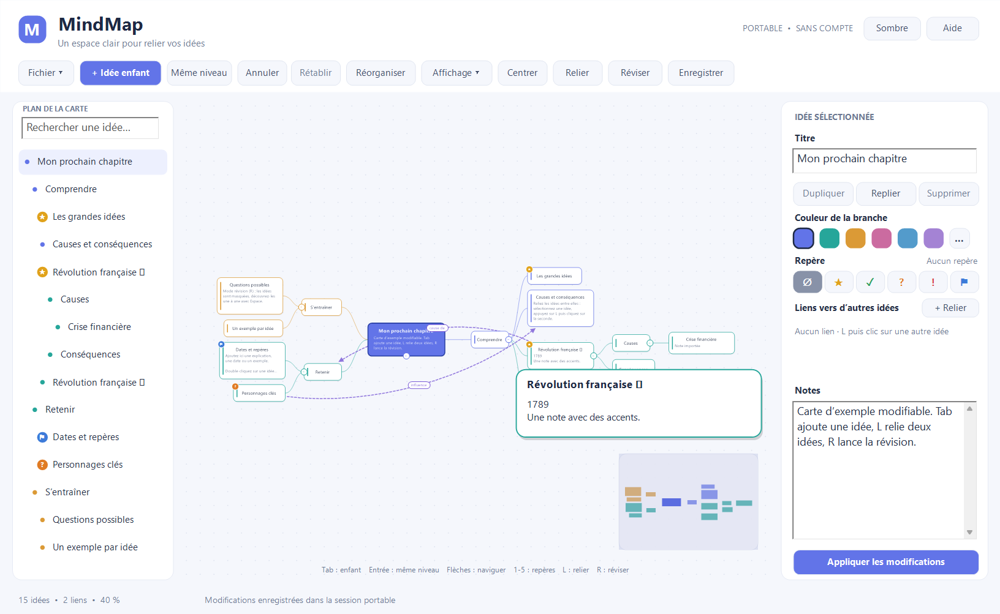
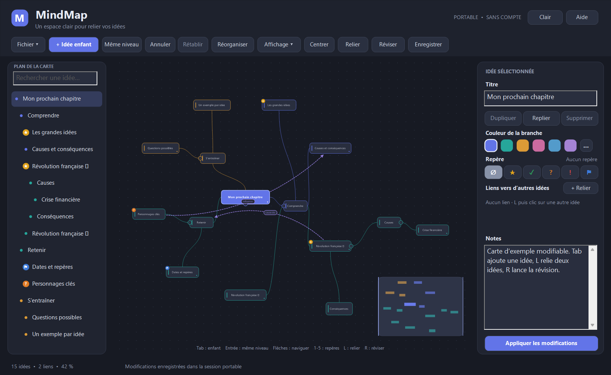
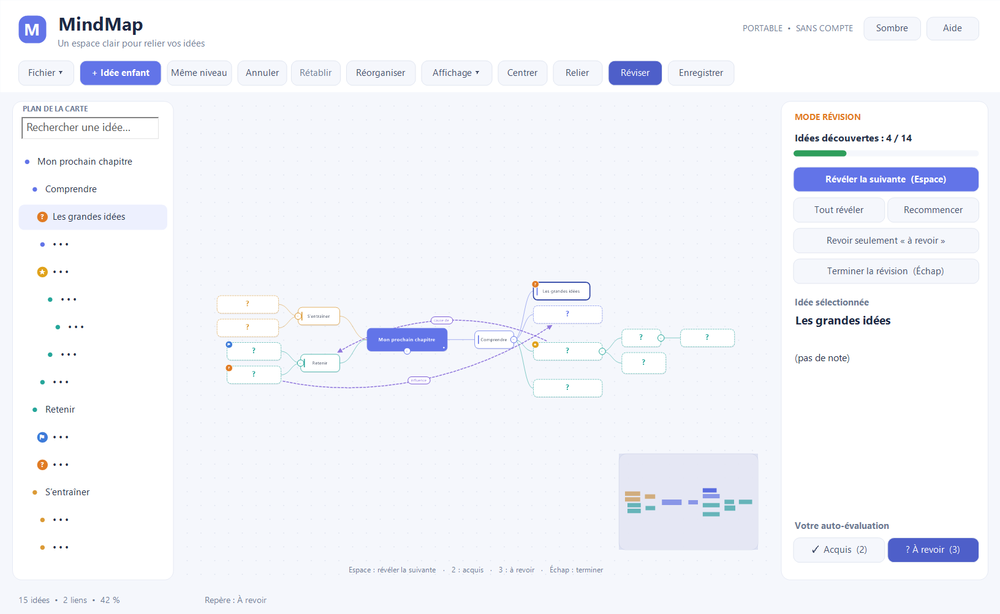

# MindMap portable

Carte mentale pour Windows, pensée pour réviser : **un seul fichier `MindMap.exe`**, sans installation, sans compte, sans connexion à Internet. Le dossier peut être copié sur une clé USB.



Téléchargez l'exécutable dans les [Releases](../../releases) ou compilez-le (voir plus bas). L'application conserve sa session dans `session.mindmap`, à côté de l'exécutable.

## Nouveautés de la version 2

| | Amélioration | En bref |
|---|---|---|
| 1 | **Mémoire et fluidité** | Historique d'annulation compressé (~10× moins de mémoire, 500 étapes au lieu de 80), plus de sérialisation complète de la carte à chaque clic, polices et image de fond réutilisées entre deux affichages, champs de texte qui ne clignotent plus |
| 2 | **Branches tout autour de l'idée principale** | Disposition équilibrée gauche/droite (par défaut), radiale à 360° ou vers la droite, sans chevauchement |
| 3 | **Affichage des détails** | Idées dont la taille suit le texte (titres sur plusieurs lignes), aperçu des notes sur la carte (N), note complète au survol, idées trouvées surlignées pendant une recherche |
| 4 | **Relier deux idées** | Liens transversaux fléchés (L puis clic), avec libellés : cause de, conséquence, s'oppose à, exemple de… ou texte libre |
| 5 | **Repères** | ★ important, ✓ acquis, ? à revoir, ! attention, ⚑ repère clé (touches 1 à 5), plus une couleur personnalisée |
| 6 | **Mode révision** | Les idées sont masquées puis découvertes une à une (Espace) ; auto-évaluation acquis / à revoir ; second passage sur les seules idées à revoir |
| 7 | **Plans texte** | Importer un plan Markdown ou texte indenté, coller un plan sous une idée (Ctrl+Maj+V), copier une branche en texte (Ctrl+Maj+C) |
| 8 | **Navigation clavier** | Les flèches passent à l'idée voisine dans la direction choisie, quelle que soit la disposition ; Origine revient au sujet central |
| 9 | **Mini-carte** | Vue d'ensemble cliquable en bas à droite (M) |
| 10 | **Thème sombre** | Interface, carte et barre de titre Windows |

Les cartes de la version 1 s'ouvrent sans changement. Les fichiers enregistrés passent au format `version 2` (liens, repères, disposition).

| Thème sombre, disposition radiale | Mode révision |
|---|---|
|  |  |

## Une première carte en une minute

1. **Fichier → Nouvelle carte**, puis renommez le sujet dans le panneau de droite.
2. Sélectionnez le sujet et appuyez sur **Tab** pour créer une idée enfant ; **Entrée** ajoute une idée au même niveau.
3. Écrivez le titre et les notes ; **Ctrl+Entrée** applique, et tout est aussi appliqué après une courte pause.
4. **L** puis un clic sur une autre idée crée un lien ; clic droit sur le lien pour lui donner un libellé.
5. **R** lance la révision ; **Ctrl+S** enregistre la carte sous le nom de votre choix.

`Exemple - révisions.mindmap` fournit un autre exemple : ouvrez-le avec **Ctrl+O** ou glissez-le sur la fenêtre. Un fichier `.md` ou `.txt` glissé sur la fenêtre est importé comme plan.

## Raccourcis

| Action | Geste |
|---|---|
| Idée enfant / même niveau | Tab / Entrée |
| Modifier un titre ou ses notes | Double-clic, ou F2 |
| Passer à l'idée voisine | Flèches ; Origine pour le sujet central |
| Relier deux idées | L (ou « Relier »), puis clic sur la seconde ; Échap annule |
| Libellé, sens ou suppression d'un lien | Clic droit sur le lien ; double-clic pour un libellé libre ; Suppr |
| Repères | 1 ★ · 2 ✓ · 3 ? · 4 ! · 5 ⚑ · 0 retire |
| Aperçu des notes / mini-carte | N / M |
| Réviser | R, puis Espace pour révéler, 2 / 3 pour s'évaluer, Échap pour terminer |
| Copier une branche en texte / coller un plan | Ctrl+Maj+C / Ctrl+Maj+V |
| Importer un plan | Ctrl+I |
| Zoomer / déplacer la vue | Molette / glisser le fond ou la mini-carte |
| Déplacer une branche / changer son parent | Glisser l'idée / Maj + glisser sur le futur parent |
| Replier une branche | Bouton + / − (il indique le nombre d'idées cachées) |
| Réorganiser / tout voir | Ctrl+L / F |
| Rechercher | Ctrl+F ; les idées trouvées sont surlignées sur la carte |
| Annuler / rétablir | Ctrl+Z / Ctrl+Y |
| Dupliquer / supprimer | Ctrl+D / Suppr |

**Affichage ▾** regroupe les dispositions, l'aperçu des notes, la mini-carte et le thème. **Aide** rappelle les raccourcis et indique la mémoire utilisée par l'historique.

## Exporter

**Fichier** exporte en **PNG**, **SVG** ou **Markdown**.

- Les images représentent les branches visibles, avec les liens, les repères et les notes affichées. Ouvrez les branches repliées avant d'exporter pour tout montrer.
- Le Markdown contient tout le plan, les notes, les repères et une section « Liens transversaux ». Il se réimporte tel quel.

## Sauvegarde et clé USB

`session.mindmap` récupère les dernières modifications au lancement suivant. Il ne remplace pas vos cartes nommées : utilisez **Ctrl+S**.

La sauvegarde écrit un fichier temporaire à côté de la destination, puis le remplace. Un message signale une clé pleine ou un dossier inaccessible. Fermez l'application et éjectez la clé avant de la retirer.

L'application ne crée pas de dossier AppData, n'écrit rien dans le registre et ne se connecte pas à Internet.

## Limites

2 000 idées, 1 000 liens, 63 niveaux sous le sujet, fichier de 8 Mio, titres de 1 024 octets UTF-8, notes de 16 000 octets, libellés de liens de 200 octets. Une seule fenêtre par dossier d'application. Pas d'images dans les idées ni d'import XMind/FreeMind. Les emojis s'affichent selon les polices Windows ; ils restent conservés dans les documents.

## Développement

```text
sources/
├── python/mindmap_core.py       modèle de l'arbre écrit en Python
├── generated/mindmap_core.cpp   sortie py2x non retouchée (empreinte dans provenance.json)
├── src/documents.hpp            JSON, format v1/v2, liens et repères
├── src/geometry.hpp             tailles des idées, dispositions, courbes (pur, testé)
├── src/exports.hpp              SVG, Markdown, import de plans, duplication avec liens
├── src/history.hpp              historique compressé (API de compression Windows)
├── src/app.cpp                  fenêtre Win32, rendu GDI+, interactions
└── tests/core_tests.cpp         tests du modèle, du format, des dispositions et de l'historique
```

Les nouveautés de la version 2 sont écrites en C++ natif autour du cœur généré, qui reste identique octet pour octet : le convertisseur py2x n'est nécessaire que pour régénérer ce cœur.

Compilation avec MinGW-w64 (GCC) et Ninja, par exemple installés avec `scoop install mingw cmake ninja` :

```bash
cmake -S sources -B sources/build -G Ninja -DCMAKE_BUILD_TYPE=Release
```

```bash
cmake --build sources/build
```

```bash
ctest --test-dir sources/build --output-on-failure
```

`sources/build/MindMap.exe --smoke-test` exerce l'interface de bout en bout (édition, liens, repères, dispositions, révision, exports) et écrit un rapport et des captures dans `sources/build/`. MSVC ne convient pas : le C++ généré utilise des extensions GCC.

L'historique détaillé de la version 1 et les retours sur py2x sont dans **RAPPORT_COMPLET.md**.

### Tests sur Linux

Le modèle, le format de document, les dispositions et les exports se testent
avec GCC sans Windows. Avec CMake, les commandes ci-dessus ne construisent que
`core_tests` sur Linux. Sans CMake :

```bash
mkdir -p sources/build
g++ -std=c++20 -O2 -Wall -Wextra sources/tests/core_tests.cpp -o sources/build/core_tests
sources/build/core_tests
python3 sources/tests/wrap_performance.py
```

Le dernier script compare le découpage UTF-8 avec le commit de référence v2
(`98b56d2`, qui doit être présent dans le dépôt Git), puis mesure les notes
courtes et longues. L'interface et l'historique compressé restent à vérifier
sous Windows avec MinGW et `--smoke-test`.
